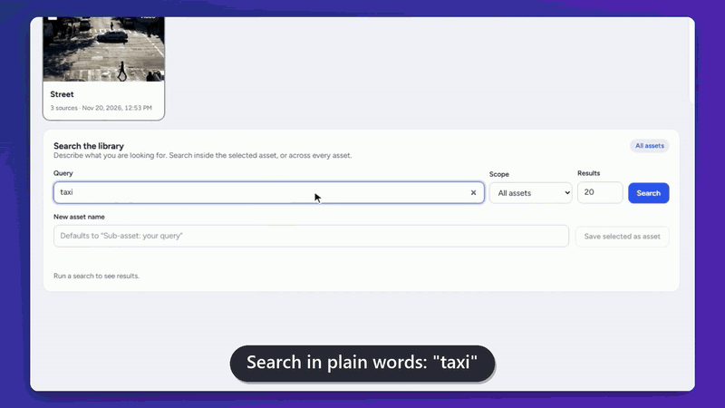
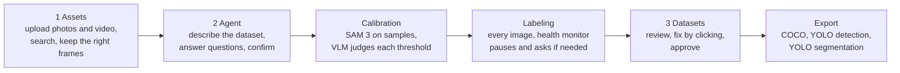
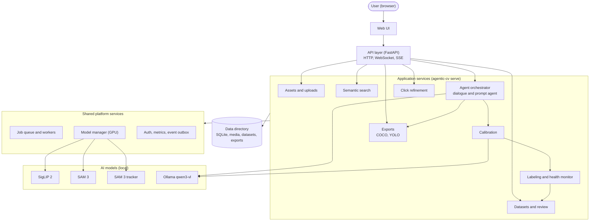
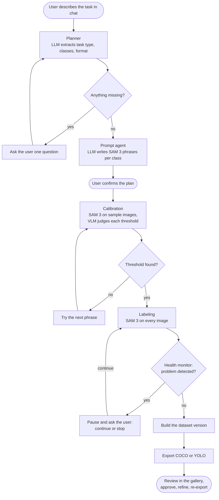
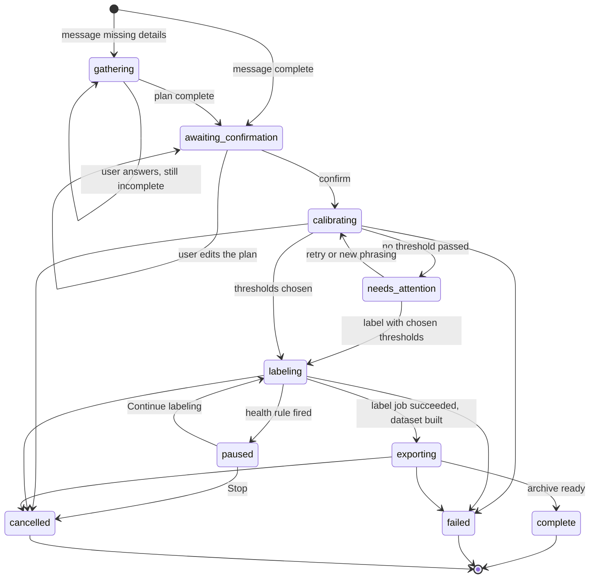
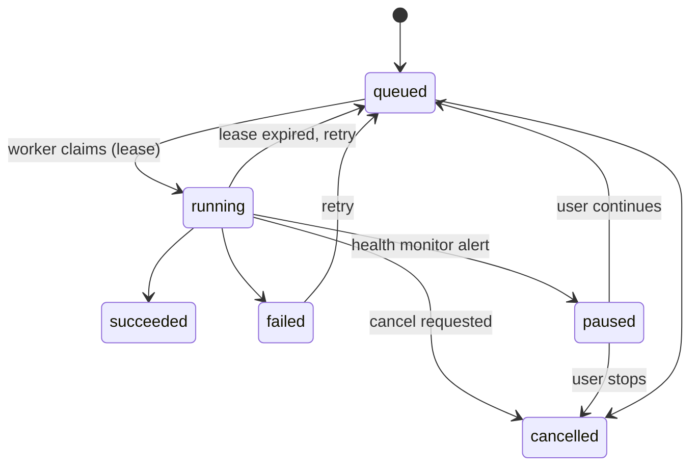

# BotFlow

Turn raw photos and video into a labeled, ready-to-train computer-vision dataset by describing what you need in a chat.

You upload media, pick the frames that matter with semantic search, and tell the agent something like *"Segment the elephants and their tusks, export YOLO"*. It asks for anything missing, tunes **SAM 3** on a few sample images with a vision-language model as the judge, labels every image while it watches the run's health, and hands you a gallery to review, fix with point-and-click segmentation, approve, and export as **COCO** or **YOLO**.

Everything runs locally on one machine with an NVIDIA GPU: models, data, and the web app. Object detection and instance segmentation are in scope; classification is not.

The command-line tool and Python package keep their technical names, `agentic-cv` and `agentic_cv`, so existing installs and scripts keep working.

| | |
|---|---|
| **Models** | SAM 3 (text-prompted segmentation and point-prompted refinement), SigLIP 2 (semantic search), `qwen3-vl:4b` via Ollama (chat planning, prompt writing, and visual validation) |
| **Stack** | Python 3.11+, FastAPI, SQLite (PostgreSQL optional), PyTorch + Transformers, plain HTML/CSS/JS UI |
| **Footprint** | Tested on an RTX 4050 Laptop GPU (6 GB) with 16 GB RAM |

## Demo



From raw street video to a reviewed taxi segmentation dataset:

| Step | What you see |
|---|---|
| 1. Upload | Three street videos go into one asset called "Street". Every frame is indexed for semantic search. |
| 2. Search | The query "taxi" returns 24 matching frames. The weak ones are unticked and the rest are saved as a new sub-asset, "Taxis" (21 images). |
| 3. Ask the agent | The message *"Segment the taxis, export YOLO"* becomes a plan: instance segmentation with the SAM 3 prompt "yellow taxi". |
| 4. Calibrate | SAM 3 runs on sample frames. The vision-language model checks each mask and settles on a threshold. |
| 5. Label | The agent labels every image in the asset, with a live preview. |
| 6. Review | The gallery shows each mask. A wrong one is deleted, and one click on the taxi segments it again. The rest are approved in one go. |
| 7. Export | The dataset downloads as a YOLO segmentation zip, ready to train. |

## Benchmarks

Measured against hand-labeled ground truth on one RTX 4050 Laptop GPU (6 GB), with the app's own code. Full method, every table, and how to reproduce: [`benchmarks/README.md`](benchmarks/README.md).

| | Open Images V7 taxis (independent, 98 images) | Demo street footage (42 frames) |
|---|---|---|
| Mask AP50, prompt `taxi` | **0.919** | 0.993 |
| Mask IoU of each matched taxi | **0.935** | 0.966 |
| F1 at the agent's calibrated threshold | **0.844** (plain SAM 3 at 0.5: 0.832) | 0.889 (plain SAM 3: 0.912) |
| Bad prompt `taxi car` | calibration refuses it | calibration refuses it (the old judge accepted it: 141 wrong cars) |
| SAM 3 speed / peak GPU memory | 0.63 to 0.69 s per image, 2,782 MiB | 0.67 to 0.80 s per image, 2,163 MiB |

The first run showed the calibration judge was too lenient: shown one image with every mask drawn, the vision model approved almost every threshold. It now judges each mask on its own crop, which made it reject prompts that label the wrong objects. A known gap remains: the calibrated threshold is often lower than the best one in hindsight.

## Contents

- [Demo](#demo)
- [Benchmarks](#benchmarks)
- [Quick start: run it on your PC](#quick-start-run-it-on-your-pc)
- [What the app does](#what-the-app-does)
- [Architecture](#architecture)
  - [App service architecture](#app-service-architecture)
  - [Services](#services)
  - [The agent workflow](#the-agent-workflow)
  - [Session lifecycle](#session-lifecycle)
  - [Background jobs](#background-jobs)
  - [GPU memory policy](#gpu-memory-policy)
- [Deploying](#deploying)
- [Configuration](#configuration)
- [Development](#development)
- [Project documents](#project-documents)

## Quick start: run it on your PC

About 20 minutes the first time, mostly downloads. Commands are for **Windows PowerShell**; where Linux or macOS differs, the alternative is given.

**You need:** an NVIDIA GPU with 6 GB or more (a CPU works, but slowly), about 30 GB of free disk, and [Git](https://git-scm.com/downloads).

### 1. Install the tools (once)

| Tool | Why | How |
|---|---|---|
| **uv** | installs Python and every dependency | Windows: `powershell -ExecutionPolicy ByPass -c "irm https://astral.sh/uv/install.ps1 \| iex"`<br/>Linux/macOS: `curl -LsSf https://astral.sh/uv/install.sh \| sh` |
| **Ollama** | runs the chat and vision model locally | download from [ollama.com/download](https://ollama.com/download) and install |
| **Hugging Face account** | SAM 3 is a gated model | 1. On [huggingface.co/facebook/sam3](https://huggingface.co/facebook/sam3), request access and wait for approval.<br/>2. Create a **Read** token at [huggingface.co/settings/tokens](https://huggingface.co/settings/tokens). |

Open a **new** terminal after installing, so `uv` and `ollama` are found.

### 2. Get the code and install

```powershell
git clone https://github.com/ghayeth-bhr/agentic-cv-platform.git
cd agentic-cv-platform
uv sync --extra ml
```

`uv sync --extra ml` creates a `.venv` folder inside the project with Python, the app, and PyTorch with GPU support. On Windows it picks the CUDA build automatically.

### 3. Get the models

```powershell
ollama pull qwen3-vl:4b     # about 3.3 GB, the chat and vision model
uv run hf auth login        # paste your Hugging Face token; it is saved for next time
```

SAM 3 and SigLIP 2 download by themselves the first time you search or label (a few GB, once).

### 4. Check your setup

```powershell
uv run agentic-cv doctor
```

It checks the GPU, the PyTorch build, Hugging Face access, Ollama, disk space, and port 8000. Fix anything marked as a failure before going on; each line says what to do.

### 5. Start the app

```powershell
uv run agentic-cv serve
```

Open **http://127.0.0.1:8000**. The defaults keep everything private and local:
- The app is reachable only from your own computer.
- Your data goes in `.agentic-cv\` inside the project folder.
- It uses port 8000. To change it, add `--port 8001`; to use another folder, add `--data-dir D:\botflow-data`.

`uv run` needs no virtual-environment activation. `.venv\Scripts\agentic-cv.exe serve` is the same command.

### 6. Try it

1. **Assets**: create an asset, upload a few photos or a short video, and wait for "indexed for search". A 15–40 second clip in 1080p is a good first test.
2. **Agent**: tick the asset and describe the job, for example *"Segment people, cars and bicycles, export COCO"*. Answer any question, then **Confirm**. Calibration and labeling run with a live preview.
3. **Datasets**: open the gallery to review, approve, and fix masks by clicking, then **Export**.

### Everyday use

| To | Do |
|---|---|
| Start | Make sure Ollama is running (its tray icon on Windows). In the project folder, run `uv run agentic-cv serve`. |
| Stop | Press **Ctrl+C** in that terminal. Your data stays, and an unfinished calibration resumes on the next start. |
| Update | Run `git pull`, then `uv sync --extra ml`, restart the app, and press **Ctrl+F5** in the browser. |

### If something goes wrong

| Symptom | Fix |
|---|---|
| `program not found` or `No such command` | Run the command from inside the `agentic-cv-platform` folder. |
| `address already in use` | Another program uses port 8000. Stop it, or start with `--port 8001`. |
| Doctor says PyTorch has no CUDA | Run `uv sync --extra ml` again, and update the NVIDIA driver. |
| The agent says it is using rules, or calibration uses the simpler check | Ollama is not running. Start the Ollama app (or run `ollama serve`), and check that `ollama list` shows `qwen3-vl:4b`. |
| `401` / `403` when SAM 3 downloads | Access to `facebook/sam3` is not approved yet, or you are not logged in. Run `uv run hf auth login` again. |
| CUDA "out of memory" | Close other GPU apps (games, other AI tools). The app loads one model at a time, but it needs about 3.5 GB free. |
| The page looks old after an update | Press **Ctrl+F5** to reload without the cache. |

To run it on a server for a team, see [Deploying](#deploying).

## What the app does

The interface follows the three steps of the job, plus a jobs view:



| Step | What you do | What happens underneath |
|---|---|---|
| **Assets** | Upload images and videos, search *"an elephant"*, untick wrong matches, save the selection as a new asset | Chunked, resumable uploads; video sampled at 1 frame/s; SigLIP 2 embeddings in a vector index |
| **Agent** | Chat: *"Segment the elephants and their tusks, export YOLO"*; answer any question; confirm | The planner fills a task spec, the prompt agent writes SAM 3 phrases, calibration picks a threshold per class, labeling runs in the background |
| **Datasets** | Approve or reject images (**A** / **R**), delete or reclassify masks, click to add a missed object, build the approved dataset, export | Annotation revisions per run, review status per image, an immutable dataset version per build, zip archives per format |
| **Jobs** | Watch indexing, labeling, and export runs | Durable jobs with leases, retries, cancel, and pause |

## Architecture

### App service architecture

Today the app is a **modular monolith**: one Python process (`agentic-cv serve`) serves the UI and the API and runs the background workers and the GPU models. Two things live outside it: the **Ollama** server for the vision-language model, and the **data directory** on disk. The export worker can optionally run as a second process on the same data volume.



What this means for operations:

- **Scale unit = one GPU host.** Labeling, indexing, calibration, and click refinement all run inside the `serve` process because they share the GPU through one model manager. Run **one** `serve` instance per data directory.
- **State is the data directory.** Back it up and you have everything except model weights (cached by Hugging Face under `~/.cache/huggingface`) and Ollama models.
- **The optional integrations are not all production-ready.**
  - PostgreSQL/pgvector replaces the SQLite stores and is tested against a real database.
  - S3/MinIO object storage stores uploads, but the labeling and search pipelines read **local** files only. Use local storage until that is closed.
  - The RabbitMQ publisher is wired into the outbox, but **no running process dispatches the outbox yet**, so events stay queued.
  - OIDC/JWT and API-key auth are implemented. Auth is off by default for local use.

### Services

The process is split into services by responsibility, each with its own module, storage, and API surface. These are the seams to cut along if parts of it later become separate deployments.

| Service | Responsibility | Modules | Storage (SQLite by default) | API |
|---|---|---|---|---|
| **Assets & uploads** | Assets, sources, chunked resumable uploads, thumbnails | `asset_registry`, `uploads`, `object_storage` | `metadata/assets.sqlite3`, `objects/`, `derived/thumbnails/` | `/v1/assets`, `/v1/uploads` |
| **Semantic search** | Frame extraction, SigLIP 2 embeddings, vector search, sub-assets from selected results | `semantic_indexing`, `semantic_search`, `persistent_vectors`, `semantic_api`, `index_worker`, `video_frames` | `metadata/vectors.sqlite3`, `metadata/sub-assets.sqlite3`, `derived/frames/` | `/v1/search`, `/v1/sub-assets`, `/v1/index-jobs` |
| **Agent** | Chat dialogue, task spec, prompt agent, calibration, run orchestration | `agent`, `agent_dialogue`, `agent_api`, `agent_worker`, `ollama_text`, `prompt_enhancement` | `metadata/agent-sessions.sqlite3` | `/v1/agent/sessions` |
| **Calibration** | One SAM 3 pass per sample, VLM verdicts, best-threshold choice, live preview | `calibration`, `calibration_samples`, `calibration_validation`, `vlm_validator`, `ollama_vlm`, `overlay` | `calibration-overlays/` | `/v1/agent/sessions/{id}/calibration-*` |
| **Labeling** | Whole-asset SAM 3 labeling, annotation revisions, health monitor | `label_workflow`, `label_worker`, `batch_labeling`, `label_monitor`, `annotation_store`, `annotation_sets` | `metadata/annotations.sqlite3`, `metadata/preview.sqlite3`, `label-health/` | `/v1/label-jobs`, `/v1/jobs/{id}/preview` (SSE) |
| **Datasets & review** | Immutable dataset versions, splits, review status, class edits, approved rebuilds | `dataset_builder`, `dataset`, `dataset_store`, `review_store`, `review_api` | `metadata/versions.sqlite3`, `metadata/reviews.sqlite3`, `dataset-images/` | `/v1/datasets`, `/v1/datasets/{id}/review` |
| **Refinement** | Point-prompted SAM 3 tracker over a WebSocket | `sam3_points`, `click_refinement` | in memory (per session) | `WS /v1/refinement/{version}/{image}`, `/v1/refinements/{id}/accept` |
| **Exports** | COCO and YOLO archives | `dataset_export`, `dataset_export_workflow`, `dataset_export_worker` | `exports/` | `/v1/dataset-exports` |
| **Platform** | Durable jobs, event outbox, auth, metrics, model manager | `job_store`, `outbox`, `auth`, `rbac`, `observability`, `model_resources` | `metadata/jobs.sqlite3`, `metadata/outbox.sqlite3` | `/v1/jobs`, `/v1/metrics`, `/health/*`, `/api-info` |

The interactive API documentation is at `/docs` (Swagger) on a running server.

### The agent workflow

The agent is deterministic where it matters. The local LLM only fills JSON schemas, and code decides what is missing, what to ask, and when a result is good enough. That keeps a 4B model reliable.



The pieces, in order:

1. **Dialogue** (`agent_dialogue.py`). The LLM extracts a draft patch; rules back it up and stand in when Ollama is down. Classes the model invents are dropped unless the user's words contain them. Detection is assumed after one unanswered question, and COCO is the default export.
2. **Prompt agent** (`prompt_enhancement.py`). It proposes short SAM 3 noun phrases per class. The user's own phrase always comes first; the model's phrases are kept as alternatives for calibration.
3. **Calibration** (`calibration.py`). SAM 3 runs once per sample, and every threshold is a score filter on that pass. The VLM judges each distinct result. When SAM 3 finds nothing, the VLM is asked whether the object is present, so a correct empty answer counts. The middle of the best-scoring run of thresholds wins, and a class that fails moves on to its next prompt.
4. **Labeling** (`label_workflow.py`, `label_monitor.py`). Each image gets one SAM 3 vision pass shared by all classes. The monitor pauses the run when most images are empty, a class is never found while others are, or masks are crowded. Resuming skips images already done.
5. **Dataset and review.** Annotations are scoped to the run, so runs never mix. Each build is an immutable version with source-aware train/val/test splits. Review status is kept per image, and **Build approved dataset** creates a version with only approved images.

### Session lifecycle



A session interrupted while `calibrating` (server stopped, crash) stays `calibrating` and is resumed automatically on the next start.

### Background jobs

All long work is a durable job in `metadata/jobs.sqlite3`, claimed by a worker with a lease and a heartbeat. If a worker dies, its lease expires and the job is re-queued.

| Kind | Worker | Produces |
|---|---|---|
| `index-asset` | index worker | SigLIP 2 vectors for every image and sampled video frame |
| `batch-label` | label worker | annotation revisions in the job's annotation set, health snapshot |
| `dataset-export` | export worker (in `serve`, or `agentic-cv worker`) | `exports/<tenant>/<version>/<format>.zip` |



Calibration is not a job row. It runs on a single-thread executor inside `serve`, and its request is stored on the agent session so it can resume.

### GPU memory policy

Three local models share one GPU through `model_resources.ModelResourceManager`. It holds one lock for inference, loads each model lazily, unloads models under memory pressure or after `AGENTIC_CV_MODEL_IDLE_UNLOAD_SEC` of idle time, and reloads them on next use. The VLM runs in Ollama, outside that manager, so calibration is **phased**: the SigLIP 2 text tower picks the samples and is unloaded; SAM 3 runs for every pending class and is unloaded; then the VLM judges. On a 6 GB card, a VLM verdict took about 4 s alone versus about 45 s with SAM 3 still resident.

| Model | Approx. VRAM | Loaded for |
|---|---|---|
| SigLIP 2 (`google/siglip2-so400m-patch14-384`) | ~2.3 GB | indexing, search, picking calibration samples |
| SAM 3 (`facebook/sam3`) | ~2 GB | calibration, labeling |
| SAM 3 tracker (same checkpoint) | ~0.9 GB | click refinement in the gallery |
| `qwen3-vl:4b` (Ollama) | ~3.5 GB | chat planning, prompt writing, calibration verdicts |

## Deploying

### Requirements

| | Minimum tested | Notes |
|---|---|---|
| GPU | NVIDIA, 6 GB VRAM, recent driver | CPU-only works for everything except reasonable speed (`AGENTIC_CV_DEVICE=cpu`) |
| RAM / disk | 16 GB / 30 GB free | Model weights ~6 GB (Hugging Face cache) + ~3.3 GB (Ollama) + your media |
| OS | Windows 11 or Linux | CI runs the test suite on Ubuntu (Python 3.11 and 3.13) |
| Python | 3.11 or newer, with [`uv`](https://docs.astral.sh/uv/) | |
| Ollama | 0.31+ with `qwen3-vl:4b` | Without it, the agent falls back to rules and calibration to a simpler check, both labeled in the UI |
| Hugging Face | access to the gated `facebook/sam3` and a token (`HF_TOKEN`) | Request access on the model page first |

### Single GPU host (recommended)

The same steps as the [Quick start](#quick-start-run-it-on-your-pc), set up for a server: a dedicated data directory, listening on the network (put auth and TLS in front, see [Security](#security)), and a token in the environment instead of an interactive login.

```bash
git clone https://github.com/ghayeth-bhr/agentic-cv-platform.git
cd agentic-cv-platform

uv sync --extra ml                 # app + PyTorch (CUDA 12.4 wheels on Windows), Transformers
ollama pull qwen3-vl:4b            # the planner, prompt agent, and VLM judge
export HF_TOKEN=...                # PowerShell: $env:HF_TOKEN = "..."

uv run agentic-cv doctor           # checks GPU, CUDA torch, model access, Ollama, disk, port
uv run agentic-cv serve --data-dir /srv/agentic-cv --host 0.0.0.0 --port 8000
```

Open `http://<host>:8000`. The first labeling run downloads SAM 3 and SigLIP 2 into the Hugging Face cache.

To run it as a service, keep **one** `serve` process per data directory under your supervisor (systemd, NSSM, or similar), with `HF_TOKEN` and any `AGENTIC_CV_*` variables in its environment. Stopping it is safe: a running calibration is cancelled cleanly and resumes on the next start, and expired job leases are re-queued.

Optionally, move exports off the main process:

```bash
uv run agentic-cv worker --data-dir /srv/agentic-cv --worker-id export-1
```

It shares the data directory (SQLite in WAL mode with a busy timeout) and only runs `dataset-export` jobs.

### Behind a reverse proxy

| Path | Protocol | Proxy setting |
|---|---|---|
| `/v1/refinement/*` | WebSocket | allow `Upgrade` / `Connection` headers |
| `/v1/jobs/{id}/preview` | Server-Sent Events | disable response buffering |
| `/v1/uploads/{id}/parts/{n}` | 5 MB chunks | body size limit ≥ 6 MB |
| `/v1/agent/sessions/{id}/confirm` with `"wait": true` | long request (minutes) | only scripts use it; the UI returns at once |

### Containers

The repository's `Dockerfile` builds **the base app without the ML extra** (no PyTorch, SAM 3, or SigLIP 2). It serves the UI and API and can run the export worker, but it cannot index or label. `docker-compose.local.yml` starts that image as `api` and `export-worker`, plus RabbitMQ and MinIO. Because of the integration gaps above, treat the compose file as a starting point, not a production stack.

A GPU image needs: a CUDA base image, `uv sync --extra ml` with the Linux CUDA wheels, the NVIDIA Container Toolkit (`--gpus all`), a volume for the data directory and one for the Hugging Face cache, `HF_TOKEN`, and `AGENTIC_CV_OLLAMA_URL` pointing at an Ollama container or host. This image is not provided or tested yet.

### Ports

| Port | Service |
|---|---|
| 8000 | `agentic-cv serve`: UI, API, WebSocket, SSE |
| 11434 | Ollama (local only; the app calls it) |
| 5672 / 15672 | RabbitMQ (compose only, optional) |
| 9000 / 9001 | MinIO (compose only, optional) |

### Data directory

Everything the app stores lives under `--data-dir` (default `.agentic-cv/`):

| Path | Contents |
|---|---|
| `metadata/*.sqlite3` | assets, jobs, outbox, vectors, sub-assets, annotations, dataset versions, reviews, agent sessions, preview events |
| `objects/` | uploaded originals (content-addressed) |
| `derived/frames/`, `derived/thumbnails/` | sampled video frames (shared by search and labeling), cached thumbnails |
| `dataset-images/` | image files of each dataset version |
| `exports/` | export folders and zip archives |
| `calibration-overlays/` | VLM evidence images and the calibration board's predictions |
| `label-health/` | the monitor's health snapshot per label job |

**Backup:** stop `serve` (or use SQLite's online backup for `metadata/`) and copy the directory. With the server running, copy each `*.sqlite3` together with its `-wal` and `-shm` files.

### Health and observability

| Endpoint | Use |
|---|---|
| `/health/live` | liveness probe (process up) |
| `/health/ready` | readiness probe. It does **not** check models or Ollama; use `agentic-cv doctor --json` for that |
| `/v1/metrics` | request and job counters |
| `/api-info` | version, endpoints, and model status (which models are loaded, VRAM) |
| logs | `AGENTIC_CV_LOG_FORMAT=json` for structured logs, level via `AGENTIC_CV_LOG_LEVEL` |

### Security

Out of the box the app is a single-user local tool: no login, and one built-in workspace (tenant). Do not expose it to a network without enabling auth. Configure OIDC/JWT (`AGENTIC_CV_OIDC_*`) with roles reader, writer, or admin, and put TLS in front. SAM 3 weights are gated and under Meta's SAM License; review [`docs/SAM3_LICENSING_REVIEW.md`](docs/SAM3_LICENSING_REVIEW.md) before any hosted use.

## Configuration

All settings are optional environment variables; the defaults suit a single local GPU machine.

| Variable | Default | Meaning |
|---|---|---|
| **Runtime and models** | | |
| `AGENTIC_CV_DEVICE` | auto (`cuda` if available) | `cpu`, `cuda`, or `cuda:<n>` |
| `AGENTIC_CV_PRECISION` | `float16` (`float32` on CPU) | `float16`, `bfloat16`, `float32` |
| `AGENTIC_CV_MODEL_HEADROOM_MB` | `512` | free VRAM kept before loading a model |
| `AGENTIC_CV_MODEL_IDLE_UNLOAD_SEC` | `300` | unload a model after this many idle seconds |
| `AGENTIC_CV_EMBEDDING_VRAM_MB` / `AGENTIC_CV_SAM3_VRAM_MB` / `AGENTIC_CV_SAM3_TRACKER_VRAM_MB` | `2304` / `2048` / `1100` | footprints used by the unload policy |
| `HF_TOKEN` | — | Hugging Face token for the gated `facebook/sam3` |
| **Agent** | | |
| `AGENTIC_CV_OLLAMA_URL` | `http://localhost:11434` | Ollama endpoint |
| `AGENTIC_CV_TEXT_MODEL` | `qwen3-vl:4b` | model for the chat planner and prompt agent |
| `AGENTIC_CV_AGENT_PLANNER` | `ollama` | `rules` skips the LLM entirely |
| `AGENTIC_CV_AGENT_PROMPTS` | `ollama` | `rules` keeps the planner but skips prompt rewriting |
| `AGENTIC_CV_OLLAMA_TIMEOUT_SEC` | `30` | planner and prompt-agent request timeout |
| **Calibration and VLM** | | |
| `AGENTIC_CV_CALIBRATION_TIMEOUT_SEC` | `120` | budget per class (a run with N classes gets N times this) |
| `AGENTIC_CV_AGENT_VALIDATOR` | VLM when reachable | `any-prediction` forces the simpler, labeled fallback |
| `AGENTIC_CV_VLM_MODEL` | `qwen3-vl:4b` | Ollama vision model for verdicts |
| `AGENTIC_CV_VLM_TIMEOUT_SEC` | `100` | per verdict; raise on first model load |
| `AGENTIC_CV_VLM_MAX_CALLS` | `50` | cap on verdicts per calibration |
| `AGENTIC_CV_VLM_MIN_CONFIDENCE` | `0.7` | minimum confidence for an accepted mask |
| `AGENTIC_CV_VLM_MIN_PREDICTION_SCORE` | `0.2` | masks scored below this make a threshold too permissive |
| `AGENTIC_CV_VLM_JUDGE` | `instance` | `instance` judges each mask on its own crop; `scene` judges one image with every mask drawn (the earlier behavior) |
| `AGENTIC_CV_VLM_MAX_SIDE` | `768` | longest side of images sent to the VLM (`0` = full size) |
| `AGENTIC_CV_VLM_PROBE_TIMEOUT_SEC` | `1.0` | Ollama reachability probe |
| **Media and refinement** | | |
| `AGENTIC_CV_VIDEO_SAMPLE_FPS` | `1.0` | video frames sampled per second |
| `AGENTIC_CV_VIDEO_MAX_FRAMES` | `1000` | per-video cap (`0` = no cap; a warning is logged when reached) |
| `AGENTIC_CV_REFINEMENT` | point tracker | `ranked` uses the older text-mask ranking for clicks |
| **Logging** | | |
| `AGENTIC_CV_LOG_FORMAT` / `AGENTIC_CV_LOG_LEVEL` | `text` / `INFO` | `json` for structured logs |
| **Optional integrations** | | |
| `AGENTIC_CV_POSTGRES_DSN`, `AGENTIC_CV_POSTGRES_SCHEMA` | unset | PostgreSQL + pgvector for every store |
| `AGENTIC_CV_S3_BUCKET`, `AGENTIC_CV_S3_ENDPOINT_URL`, `AWS_REGION` | unset | S3/MinIO for uploads (see the deployment notes) |
| `AGENTIC_CV_RABBITMQ_HOST`, `_PORT`, `_VHOST`, `_USER`, `_PASSWORD`, `_EXCHANGE` | unset | RabbitMQ event publisher (outbox dispatch not yet running) |
| `AGENTIC_CV_OIDC_ISSUER`, `_AUDIENCE`, `_JWKS_URL`, `_ROLES_CLAIM`, `_TENANT_CLAIM` | unset | OIDC/JWT authentication |

## Development

```bash
uv sync                                   # app + dev tools (no GPU needed)
uv run python -m playwright install chromium
uv run pytest -q                          # ~370 tests, fake models, no GPU or network
```

- Tests use fake models and need no GPU, network, or running services. Browser journeys (Playwright) skip if Chromium is not installed. PostgreSQL tests run with `AGENTIC_CV_TEST_POSTGRES_DSN` set (`pytest -m postgres`).
- CI (`.github/workflows/ci.yml`) installs the `dev` dependency group and Chromium and runs the full suite on Ubuntu with Python 3.11 and 3.13.
- Real-model checks are scripts, not tests:
  - `scripts/real_agent_journey.py`: chat → calibration → labeling → YOLO export.
  - `scripts/real_ui_calibration_board.py` and `scripts/real_ui_review.py`: the same flows in a real browser.
  - Measurements are recorded in [`docs/PERFORMANCE.md`](docs/PERFORMANCE.md).
- The UI has no build step: edit `src/agentic_cv/web/` and hard-refresh (Ctrl+F5).

```text
src/agentic_cv/
  application.py        composition root: stores, models, workers, routers
  cli.py                agentic-cv serve | worker | doctor
  web/                  index.html, app.js, app.css
  agent*.py             dialogue, orchestration, API, worker
  calibration*.py       engine, sample selection, validator choice
  label_*.py            workflow, worker, monitor, image resolver
  dataset*.py           model, builder, store, export
  review_*.py           review status and API
  semantic_*.py         indexing, search, API
  sam3*.py              SAM 3 provider, point tracker, multipart service
  postgres_*.py         optional PostgreSQL stores
tests/                  unit, HTTP, and Playwright tests
scripts/                real-model and load measurements
docs/                   plan, branch records, performance, licensing
```

## Project documents

- [`docs/OPTIMIZATION_PLAN.md`](docs/OPTIMIZATION_PLAN.md): the review, rating, and phased plan this version implements.
- [`docs/branches/`](docs/branches/README.md): one record per branch (scope, validation, limitations). Recent ones:
  - [data correctness](docs/branches/data-correctness.md)
  - [agent dialogue](docs/branches/agent-dialogue.md)
  - [search selection](docs/branches/search-selection.md)
  - [calibration engine](docs/branches/calibration-engine.md)
  - [live calibration](docs/branches/calibration-live.md)
  - [review and approval](docs/branches/review-approval.md)
  - [label monitor](docs/branches/label-monitor.md)
  - [assets at scale](docs/branches/assets-scale.md)
- [`docs/PERFORMANCE.md`](docs/PERFORMANCE.md): measured runs on the 6 GB laptop GPU.
- [`docs/SAM3_LICENSING_REVIEW.md`](docs/SAM3_LICENSING_REVIEW.md): SAM 3 licence notes.

## License

No license file is included yet. SAM 3, SigLIP 2, and Qwen3-VL weights have their own terms; review them before redistribution or hosted use.
